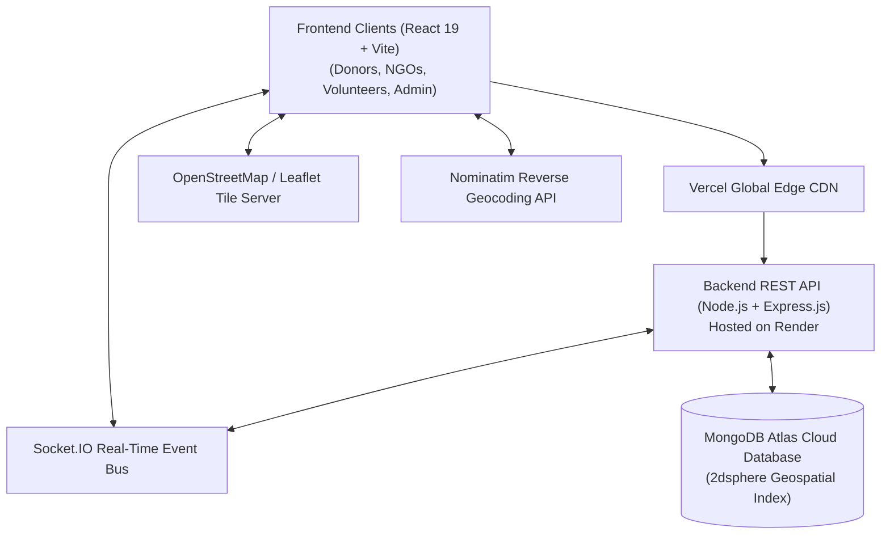
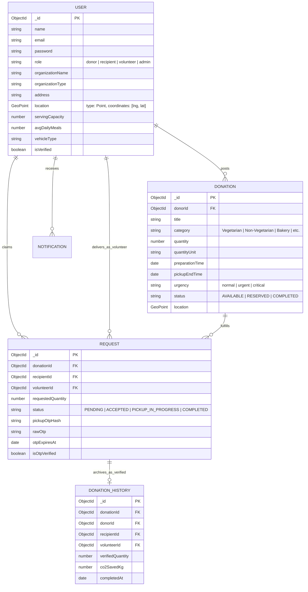

# FoodResQ – Intelligent Food Rescue & Redistribution Platform

> **"Rescue Food. Feed Lives."**  
> *Every meal deserves a destination.*

FoodResQ is an advanced, full-stack social-impact technology platform built to eliminate commercial food waste by connecting restaurants, hotels, caterers, grocery shops, and community kitchens with verified NGOs, charitable shelters, and volunteer fleets to redistribute surplus edible food in real time.

---

## 🌟 Key Features

### 1. Visual Design & Aesthetics
- **Curated Palette**:
  - Primary Orange: `#FF8A3D`
  - Warm Cream: `#FFF7E6`
  - Deep Forest Green: `#0F5132`
  - Bright Green: `#22C55E`
  - Golden Yellow: `#FACC15`
  - Dark Text: `#10251D`
- **Modern Startup UI**: Large rounded cards, glassmorphism accents, soft shadows, micro-interactions, responsive mobile drawer, and high-resolution warm photography.

### 2. Four Dedicated Role Dashboards
- **🍽️ Donor Dashboard** (Restaurants, Caterers, Hotels):
  - Statistic cards: Total Donations, Active Listings, Pending Requests, Completed Donations, Meals Redistributed.
  - Interactive Recharts monthly redistribution trend chart.
  - "Add Food Donation" modal with food safety handling guidelines, storage temperatures, allergens, and Hyderabad geo coordinates.
  - One-click Accept / Reject incoming requests with automatic inventory restoration on cancellation.
- **🏠 NGO / Recipient Dashboard** (Verified Charities & Shelters):
  - Discovery catalog with product-style food cards and urgency countdown timers.
  - Multi-criteria filtering by category, distance, quantity, and urgency.
  - Toggle between Grid Cards view and Interactive OpenStreetMap / Leaflet map view.
  - Real-time reservation modal with atomic availability check preventing double-booking.
  - Display of accepted pickups with cryptographic single-use QR and OTP tokens.
- **🛵 Volunteer Dashboard** (Rescue Logistics Agents):
  - Active pickup and drop-off navigation routes (Restaurant Origin &rarr; NGO Destination).
  - Single-use 6-digit OTP verification keypad.
  - Handover confirmation with driver remarks and rating ledger.
- **🛡️ Admin Command Portal** (Trust & Safety):
  - Real-time system counters: Total Users, Donors, NGOs, Donations, Deliveries, Open Reports.
  - User management with 1-click Organization Verification toggles and Account Suspension.
  - Listing moderation with one-click removal.
  - Community safety and dispute report resolution.
  - One-click sample database reset and auto-seeding.

### 3. Smart Food Matching Engine (Explainable 5-Factor Algorithm)
Transparent, deterministic rule-based scoring engine (0–100%) showing the breakdown:
- **Distance (30%)**: Haversine distance between donor and NGO facility.
- **Category Compatibility (25%)**: Alignment with dietary & distribution preferences.
- **Serving Capacity (20%)**: Compatibility between batch quantity and NGO's daily throughput.
- **Pickup Window (15%)**: Transit feasibility before food expiration.
- **Verification Status (10%)**: Certified hygiene and compliance bonus.

### 4. Cryptographic Single-Use OTP & QR Verification
- Generates 6-digit OTP and high-resolution QR code (`qrcode` package) upon donor approval.
- Bcrypt hash validation in MongoDB.
- 12-hour expiration window and single-use invalidation upon handover.
- Automatic creation of immutable `DonationHistory` records.

### 5. Verified Social Impact Analytics
- Interactive Recharts graphs: Monthly Trends Area Chart, Category Distribution Pie Chart, and Hyderabad Locality Table.
- Confirmed metrics calculated exclusively from physically verified handovers.
- Environmental carbon offset calculations (EPA 2.5 kg CO₂e saved per kg food diverted).

---

## 🏗️ System Architecture Diagram



---

## 🗄️ Database Design / ER Diagram



---

## 🔑 Administrator & Testing Credentials

| Role | Organization / Persona | Email | Password | Access Level |
| :--- | :--- | :--- | :--- | :--- |
| **Admin** | FoodResQ Platform Trust & Safety (Rohan Varma) | `admin@foodresq.org` | `password123` | Full admin moderation & analytics |
| **Donor** | Paradise Biryani House (Chef Suresh Reddy) | `donor@foodresq.org` | `password123` | Surplus food creation & management |
| **Recipient (NGO)** | Akshaya Meals Foundation (Kavita Menon) | `ngo@foodresq.org` | `password123` | Claiming food & viewing OTP token |
| **Volunteer** | City Rescue Fleet (Vikram Rao) | `volunteer@foodresq.org` | `password123` | Delivery route & OTP verification |

---

## 🛠️ Technology Stack

- **Frontend**: React 19, Vite, Vanilla CSS design system, Lucide React, Leaflet & React-Leaflet, Recharts, Canvas-Confetti, Socket.IO Client.
- **Backend**: Node.js, Express.js REST API (`/api/v1`), MongoDB Atlas with `2dsphere` geospatial indexing, JWT Authentication, bcryptjs, Socket.IO, QRCode.
- **Real-Time Push**: Socket.IO bi-directional notification engine with document persistence.
- **Documentation**: [API Documentation](API_DOCUMENTATION.md) for full endpoint specifications.

## 🚀 Getting Started

### 1. Prerequisites
- **Node.js** v18+ and **npm** installed.
- **MongoDB** running locally on port `27017` or a MongoDB Atlas URI in `backend/.env`.

### 2. Backend Setup
```bash
cd backend
npm install
npm run seed     # Populates database with Hyderabad demo accounts and listings
npm start        # Launches API on port 5000
```

### 3. Frontend Setup
```bash
cd frontend
npm install
npm run dev      # Launches Vite frontend on http://localhost:5173
```

---

## 📄 Food Safety Disclaimer
FoodResQ is a coordination platform, not a food-safety inspection or certification service. Donors are responsible for accurate information and compliance with applicable food-safety regulations. Recipients should independently assess donations before accepting or distributing them.
